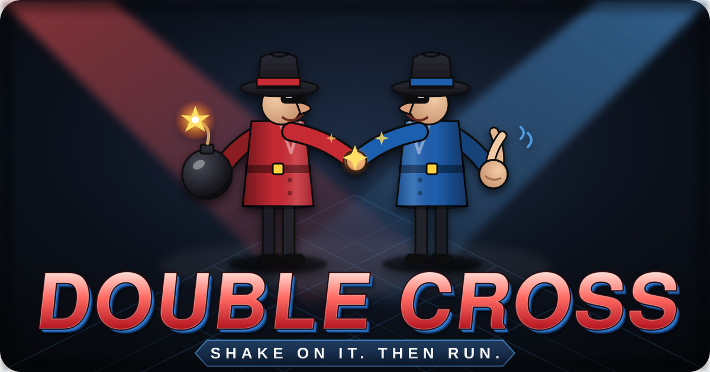
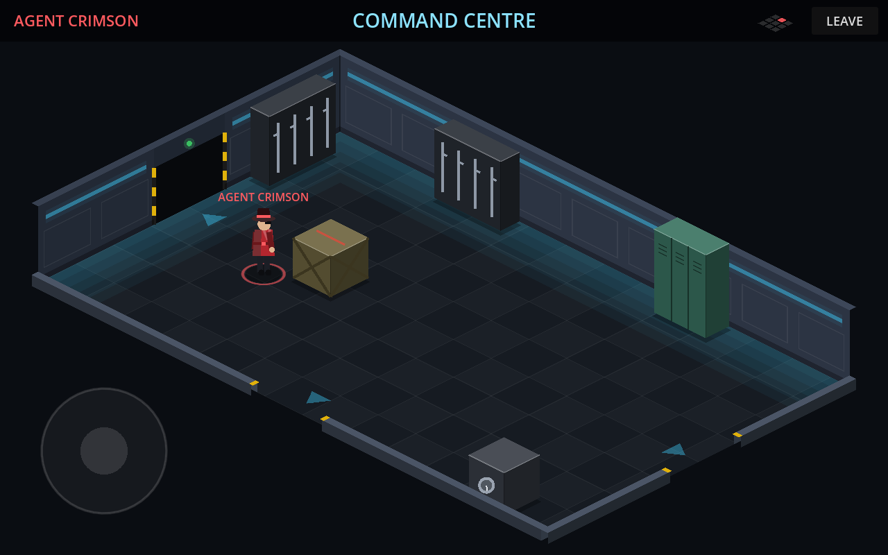
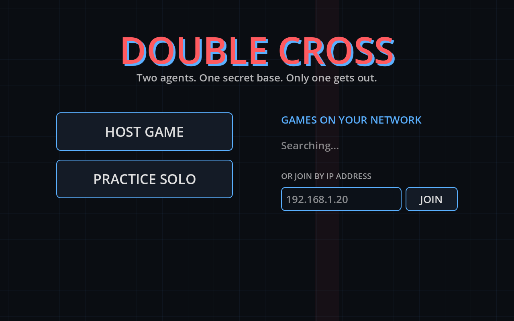

<p align="center">
  
</p>

<p align="center">
  <b>Two rival agents. One secret base. Only one gets out.</b><br>
  A two-player, one-tablet-each game of sneaking, booby traps and very bad manners.
</p>

<p align="center">
  <a href="../../actions/workflows/android.yml"></a>
  
  
  
</p>

---

## The idea

Agent **Crimson** and Agent **Cobalt** have both broken into the same secret
base to steal the same intel. Each player has their own Android tablet on the
same Wi-Fi network, so neither can see what the other is up to.

- **Explore** a grid of isometric rooms: the Reactor Core, the Armoury, the Server Vault…
- **Search** desks, lockers, safes and crates for the mission items and the escape key.
- **Booby-trap** the furniture and doorways for your rival to find the hard way.
- **Carry the right gadget** to disarm a trap before it disarms you.
- **Fight** when you meet in the same room: melee *or* a dart pistol.
- **Escape** with everything before your own clock runs out. Dying costs you time.

It's a love letter to the split-screen trap-and-sneak games of the 8-bit era,
rebuilt with an original setting, original characters and a lot more polish.

<p align="center">
  
  
</p>

## Status and roadmap

| | Milestone | Status |
|---|---|---|
| 1 | Two players on separate tablets moving through a shared, synced base over the local network | ✅ Done |
| 2 | Searching furniture, mission items, escape door and the win condition | ⏳ Next |
| 3 | Traps and counter-gadgets (tripwire ⇄ wire cutters, paint bomb ⇄ extinguisher…) | 🔜 |
| 4 | Combat (melee and dart pistol), per-player countdown and respawn penalty | 🔜 |
| 5 | Art pass, sound, music, menus, settings | 🔜 |

What works today:

- Host a game on one tablet. The other tablet finds it automatically, or you can type the host's IP address.
- A seeded 3×3 secret base. Both tablets build the identical map from one shared number.
- Isometric rooms with depth-sorted furniture, doors and a mini-map.
- Touch joystick (left half of the screen), plus WASD or arrow keys on a computer.
- You only see your rival when you're in the same room.

## Playing it

### On two Android tablets

1. Open the [**Actions** tab](../../actions/workflows/android.yml), click the latest green run,
   and download the **double-cross-apk** artifact (it's a zip with the APK inside).
2. Copy `double-cross.apk` to each tablet and open it. Android will ask you to allow
   installs from that source the first time.
3. Put both tablets on **the same Wi-Fi network**.
4. On one tablet tap **HOST GAME**. On the other, tap the game that appears under
   **GAMES ON YOUR NETWORK**, or type the IP address shown on the host's screen.

> Some routers (guest networks, many office and hotel Wi-Fi networks) block
> devices from seeing each other. If the game doesn't show up, use the IP
> address instead, or try a phone hotspot.

### On a Mac (or Windows/Linux) for testing

You don't need a tablet to try it. The game runs on a computer and can play
against itself.

1. Install **Godot 4.3** from [godotengine.org](https://godotengine.org/download/archive/4.3-stable/)
   (the standard version, not .NET). It runs natively on Apple Silicon.
2. In Godot, choose **Import** and pick this folder's `project.godot`.
3. **Solo:** press ▶ (or <kbd>⌘</kbd>+<kbd>B</kbd>) and choose **PRACTICE SOLO**. Move with WASD/arrows or drag with the mouse.
4. **Two players on one Mac:** go to **Debug → Customize Run Instances…**, tick
   **Enable Multiple Instances**, set it to **2** and press ▶. In one window click
   **HOST GAME**. In the other, type `127.0.0.1` and click **JOIN**.

## Controls

| Action | Tablet | Keyboard |
|---|---|---|
| Move | Drag anywhere on the left half of the screen | WASD / arrow keys |
| Leave match | **LEAVE** button / Android back | Close window |

Search, trap and attack buttons arrive with milestones 2 to 4.

## How it's built

- **[Godot 4.3](https://godotengine.org/)** using GDScript and the *Compatibility* renderer, so it runs on older tablets too.
- **Networking:** host-and-join over ENet on UDP port `47810`. LAN discovery broadcasts on UDP port `47811`.
- **No art files yet:** rooms, furniture and agents are drawn in code, so the art can be replaced piece by piece later.
- **Isometric projection:** the game logic happens on a flat floor plan, and the renderer projects it to isometric. The controls are screen-relative.

```
scripts/
  main.gd       menu ⇄ match flow, starts the match on both tablets
  net.gd        hosting, joining, LAN discovery (autoload "Net")
  world.gd      the seeded base layout + isometric projection maths
  game.gd       one match: spawns agents, reads input
  agent.gd      movement, collisions, doors, network sync, agent artwork
  room_view.gd  isometric room renderer (walls, floor, furniture, depth sorting)
  hud.gd        top bar, mini-map, joystick, room-change fade
  joystick.gd   floating touch joystick
  menu.gd       title screen
.github/workflows/android.yml   builds the APK on every push
```

### Building the APK yourself

Every push to `main` builds a debug APK automatically with GitHub Actions. To
build locally instead, install the Android SDK and OpenJDK 17, set their paths in
**Editor → Editor Settings → Export → Android**, then use **Project → Export… → Android**.

`android/debug.keystore` is a throwaway **debug-only** signing key (password
`android`). It's committed so that every build is signed the same way and
installs over the previous one. Never use it for a store release.

## Licence

[MIT](LICENSE). Do what you like, just keep the notice.
