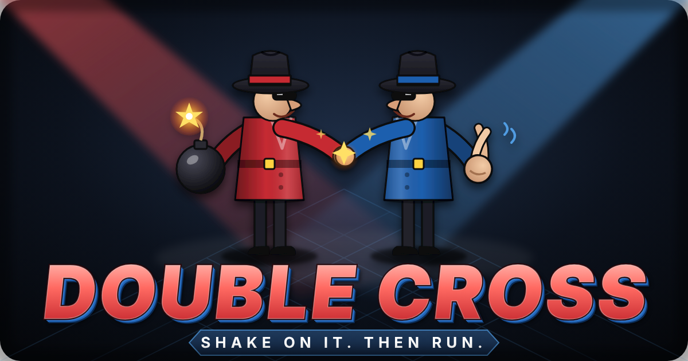
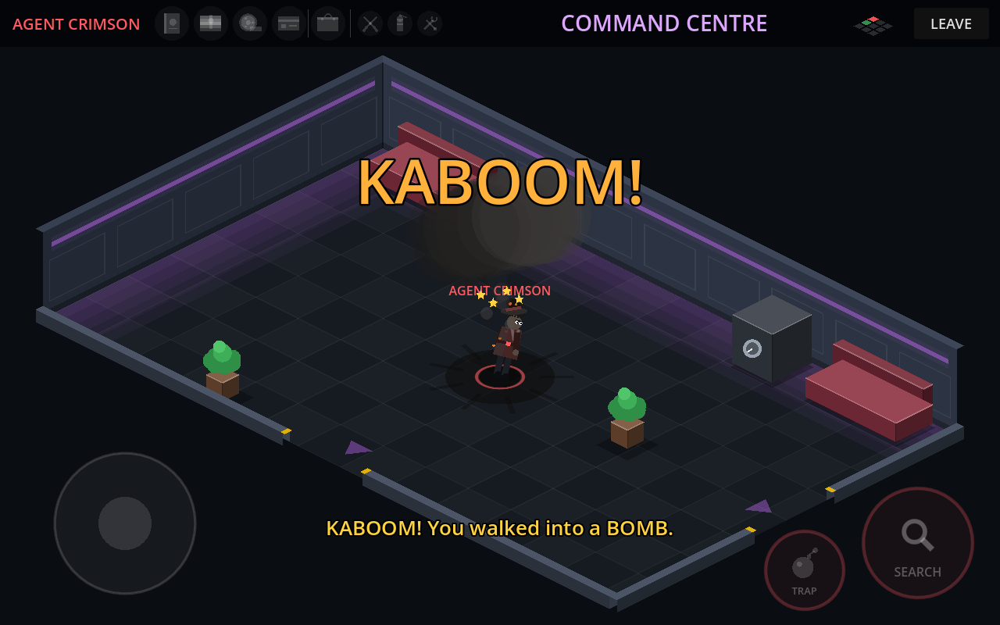

<p align="center">
  
</p>

<p align="center">
  <b>Two rival agents. One secret base. Only one gets out.</b><br>
  A two-player, one-tablet-each game of sneaking, booby traps and very bad manners.
</p>

<p align="center">
  <a href="../../actions/workflows/android.yml"></a>
  
  
  
</p>

---

## The idea

Agent **Crimson** and Agent **Cobalt** have both broken into the same secret
base to steal the same intel. Each player has their own Android tablet on the
same Wi-Fi network, so neither can see what the other is up to.

- **Explore** a grid of isometric rooms: the Reactor Core, the Armoury, the Server Vault…
- **Search** desks, lockers, safes and crates for the mission items and the escape key.
- **Booby-trap** the furniture and doorways for your rival to find the hard way.
- **Carry the right gadget** to disarm a trap before it disarms you.
- **Fight** when you meet in the same room: melee *or* a dart pistol.
- **Escape** with everything before your own clock runs out. Dying costs you time.

It's a love letter to **Spy vs. Spy**, the 1984 split-screen classic where two
spies booby-trapped an embassy while hunting for a briefcase full of secrets.
Double Cross keeps that mischievous trap-and-sneak spirit but is rebuilt from
scratch: one device per player over Wi-Fi, an isometric secret base, its own
characters, artwork, music and code. See [Acknowledgements](#acknowledgements).

<p align="center">
  
  
</p>
<p align="center">
  
</p>

## Status and roadmap

| | Milestone | Status |
|---|---|---|
| 1 | Two players on separate tablets moving through a shared, synced base over the local network | ✅ Done |
| 2 | Searching furniture, mission items, briefcase, escape door and the win condition | ✅ Done |
| 3 | Traps and counter-gadgets (bomb ⇄ extinguisher, spring trap ⇄ toolkit, tripwire ⇄ wire cutters) | ✅ Done |
| 4 | Combat (cosh and dart pistol), per-player countdown and respawn penalty | ✅ Done |
| 5 | Sound, music, menus, settings | ✅ Done |
| 6 | Richer, more detailed graphics: textures, lighting, shading, wall decor | ✅ Done |
| 7 | Bot difficulty levels: easy (walks into its own traps), medium, hard | ✅ Done |
| ★ | One-player mode against a bot | ✅ Done |
| ★ | Phones as well as tablets, and a Mac app | ✅ Done |

What works today:

- Host a game on one tablet. The other tablet finds it automatically, or you can type the host's IP address.
- A seeded 3×3 secret base. Both tablets build the identical map from one shared number.
- Isometric rooms with depth-sorted furniture, doors and a mini-map.
- Touch joystick (left half of the screen), plus WASD or arrow keys on a computer.
- Works on phones as well as tablets: wide screens get a wider view, and on small screens the controls and text are scaled up. You can mix a phone and a tablet in one match.
- You only see your rival when you're in the same room.
- Four pieces of intel (PASSPORT, CASH, MICROFILM, KEYCARD) and a BRIEFCASE are hidden in the furniture. There's only one of each, so it's a race.
- Without the briefcase you can carry just one item. Search with full hands and you swap: your item stays behind in that furniture for your rival to find.
- The EXIT (green on the mini-map) only opens for an agent carrying all four pieces of intel. First one out wins, then the host can call a rematch on a freshly shuffled base.
- The host's tablet referees every search and escape, so both tablets always agree on who has what.
- **Traps:** hide a BOMB or SPRING TRAP in furniture, or string a TRIPWIRE across a doorway. Only you can see your own traps (up to three at a time), and yes, you can walk into them yourself.
- **Getting caught** knocks you out for a few seconds and sends any intel you're carrying flying into the furniture around the room.
- **Gadgets:** the EXTINGUISHER beats the bomb, the TOOLKIT beats the spring trap and the WIRE CUTTERS beat the tripwire. Each is used up when it saves you and turns up again somewhere else in the base.
- **Clocks:** each agent has 6 minutes. If your clock runs out, you lose. Traps cost 20 seconds; being taken out costs 30.
- **Fighting:** swing your cosh up close or fire your dart pistol (3 darts per life, auto-aims at a rival roughly in front of you). Three hits take an agent out: they drop their intel and wake up back in their starting room.
- **Sound:** an original spy-jazz soundtrack and sound effects, all synthesised by `tools/make_audio.py` (no samples). Explosions in other rooms sound muffled through the walls; the music speeds up when your clock drops under a minute.
- **Codenames:** type your own agent name on the title screen. It's saved, and in a two-player game it's sent to your rival.
- **Settings and How to Play** on the title screen: music and effects volume, vibration, and the clock length (4–10 minutes).
- **PLAY VS BOT**: a one-player mode against a computer agent that plays by the same rules. It has to search to find things, can only carry one item until it finds the briefcase, and sets traps of its own. Pick EASY (slow, a bit forgetful, and now and then sets off its own traps), MEDIUM or HARD.

## Playing it

### On two Android tablets (or phones)

1. Open the [**Actions** tab](../../actions/workflows/android.yml), click the latest green run,
   and download the **double-cross-apk** artifact (it's a zip with the APK inside).
2. Copy `double-cross.apk` to each tablet and open it. Android will ask you to allow
   installs from that source the first time.
3. Put both tablets on **the same Wi-Fi network**.
4. On one tablet tap **HOST GAME**. On the other, tap the game that appears under
   **GAMES ON YOUR NETWORK**, or type the IP address shown on the host's screen.

> Some routers (guest networks, many office and hotel Wi-Fi networks) block
> devices from seeing each other. If the game doesn't show up, use the IP
> address instead, or try a phone hotspot.

### As a Mac app

1. Open the [**Actions** tab](../../actions/workflows/android.yml), click the latest green run and
   download **double-cross-mac**. Unzip it, then unzip `DoubleCross-macOS.zip` inside to get **Double Cross.app**.
   It runs natively on Apple Silicon and Intel Macs.
2. Drag it into **Applications**.
3. The app isn't signed with an Apple developer certificate, so the first time you open it macOS will
   refuse. Open **System Settings → Privacy & Security**, scroll down and click **Open Anyway** next to the
   Double Cross message. Or run this once in Terminal:

   ```bash
   xattr -dr com.apple.quarantine "/Applications/Double Cross.app"
   ```
4. When macOS asks whether Double Cross may find devices on your local network, click **Allow**.
   It needs that to find and join games.

A Mac can play against tablets and phones on the same Wi-Fi.

### From source in Godot (Mac, Windows or Linux)

You don't need a tablet to try it. The game runs on a computer and can play
against itself.

1. Install **Godot 4.3** from [godotengine.org](https://godotengine.org/download/archive/4.3-stable/)
   (the standard version, not .NET). It runs natively on Apple Silicon.
2. In Godot, choose **Import** and pick this folder's `project.godot`.
3. **Solo:** press ▶ (or <kbd>⌘</kbd>+<kbd>B</kbd>) and choose **PLAY VS BOT** (or **PRACTICE SOLO** to explore alone). Move with WASD/arrows or drag with the mouse.
4. **Two players on one Mac:** go to **Debug → Customize Run Instances…**, tick
   **Enable Multiple Instances**, set it to **2** and press ▶. In one window click
   **HOST GAME**. In the other, type `127.0.0.1` and click **JOIN**.

## Controls

| Action | Tablet | Keyboard |
|---|---|---|
| Move | Drag anywhere on the left half of the screen | WASD / arrow keys |
| Search nearby furniture (it glows) | **SEARCH** button (bottom right) | <kbd>E</kbd> or <kbd>Space</kbd> |
| Set a trap | **TRAP** button, then pick BOMB, SPRING or WIRE | <kbd>1</kbd> bomb, <kbd>2</kbd> spring, <kbd>3</kbd> tripwire |
| Cosh (melee) | **ATTACK** button | <kbd>F</kbd> |
| Fire a dart | **FIRE** button | <kbd>G</kbd> |
| Escape | Walk into the EXIT with all four items | |
| Leave match | **LEAVE** button / Android back | Close window |


## How it's built

- **[Godot 4.3](https://godotengine.org/)** using GDScript and the *Compatibility* renderer, so it runs on older tablets too.
- **Networking:** host-and-join over ENet on UDP port `47810`. LAN discovery broadcasts on UDP port `47811`.
- **No art files yet:** rooms, furniture and agents are drawn in code, so the art can be replaced piece by piece later.
- **Isometric projection:** the game logic happens on a flat floor plan, and the renderer projects it to isometric. The controls are screen-relative.

```
scripts/
  main.gd       menu ⇄ match flow, starts the match on both tablets
  net.gd        hosting, joining, LAN discovery (autoload "Net")
  world.gd      the seeded base layout + isometric projection maths
  game.gd       one match: spawns agents, reads input, rules (search/swap/escape)
  agent.gd      movement, collisions, doors, network sync, agent artwork
  room_view.gd  isometric room renderer (walls, floor, furniture, depth sorting)
  hud.gd        top bar, mini-map, joystick, room-change fade
  joystick.gd   floating touch joystick
  menu.gd       title screen
  bot.gd        computer opponent (room-to-room routing + AStarGrid2D within rooms)
  ui.gd         phone/tablet screen-size helpers
  sound.gd      sound effects, music and audio buses (autoload "Sound")
  settings.gd   saved player settings (autoload "Settings")
tools/make_audio.py   synthesises every sound and the music into assets/audio/
tools/blender/build_agents.py   models, poses and renders the agents in Blender
                                into isometric sprite sheets (assets/sprites/)
  action_button.gd  multi-touch round button (SEARCH, and later TRAP/ATTACK)
  icons.gd      drawn item icons
.github/workflows/android.yml   builds the Android APK and the Mac app on every push
```

### Re-rendering the agents in Blender

The agents are 3D models built, posed and rendered entirely by script, using
Blender 4.2 as a Python module. `tools/blender/agent_model.py` sculpts each
spy procedurally: an organic body skinned around a jointed skeleton (so knees
and elbows really bend), a shaped head with a big spy nose, brows, smirk and
wraparound shades, a snap-brim fedora with pinched crown and ribbon, a
popped-collar trench coat with belt and double-breasted buttons, gloves and
polished shoes, all with woven-fabric, felt, leather and skin materials.
`tools/blender/build_agents.py` poses it (forward kinematics) and renders 8
directions × 20 frames (idle, walk, search, cosh swing, hurt, knocked down)
with ink outlines from an orthographic camera at the game's isometric angle.

```bash
python3.11 -m venv .blendenv
.blendenv/bin/pip install bpy==4.2.0 pillow
.blendenv/bin/python tools/blender/build_agents.py
```

`--preview` renders small, fast sheets for trying out changes. If the sheets
are missing, the game falls back to the original drawn-in-code agents.

### Building the APK yourself

Every push to `main` builds a debug APK and a Mac app automatically with GitHub Actions. To
build locally instead, install the Android SDK and OpenJDK 17, set their paths in
**Editor → Editor Settings → Export → Android**, then use **Project → Export… → Android**.

`android/debug.keystore` is a throwaway **debug-only** signing key (password
`android`). It's committed so that every build is signed the same way and
installs over the previous one. Never use it for a store release.

## Acknowledgements

Double Cross is inspired by **Spy vs. Spy** (1984), the computer game by
First Star Software based on Antonio Prohías's *Spy vs. Spy* comic strip in
*MAD* Magazine, and by the many happy hours spent playing it split-screen on
8-bit machines.

Double Cross is an independent, original fan project. It does not use any
artwork, characters, names, music or code from Spy vs. Spy, and is not
affiliated with, endorsed by or connected to First Star Software, *MAD*
Magazine, DC Comics or Warner Bros. *Spy vs. Spy* is a trademark of its
respective owners.

## Licence

Copyright © 2026 petherin. **All rights reserved.** The code is public so you can
look at it, but you may not copy, reuse, modify or distribute any of it without
written permission. See [LICENSE](LICENSE).
