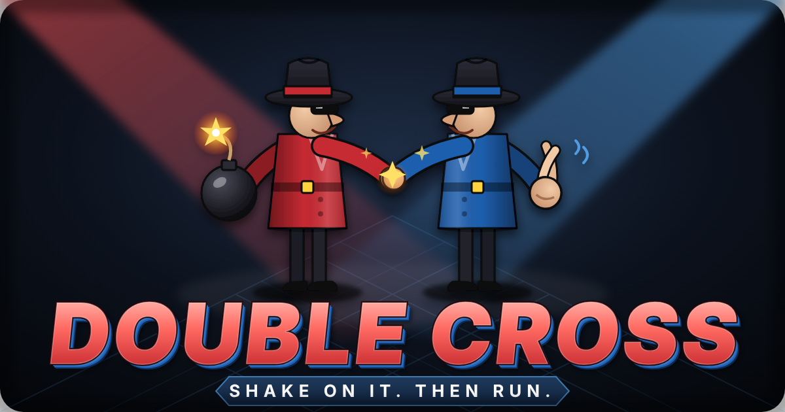
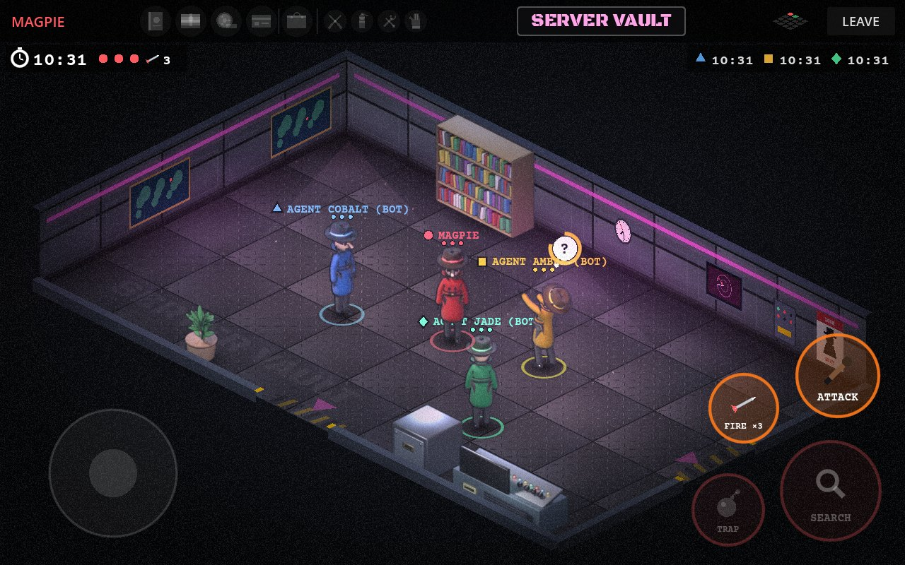
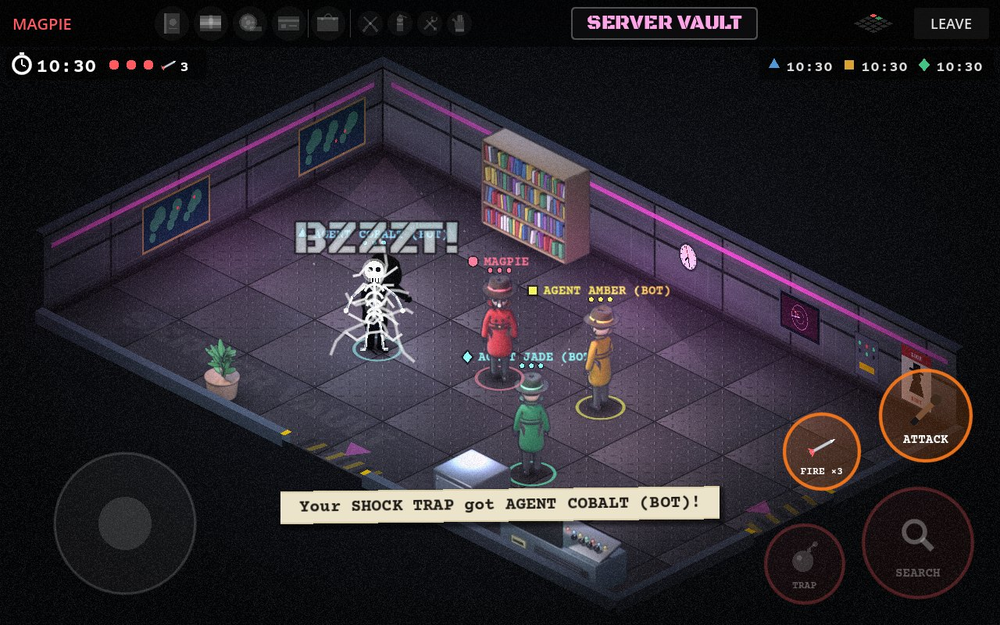
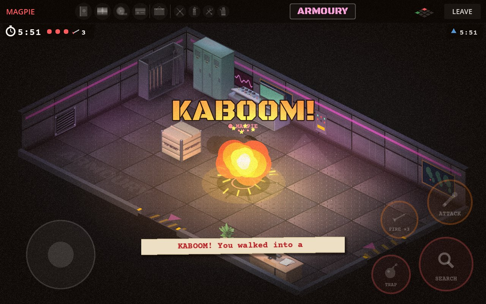
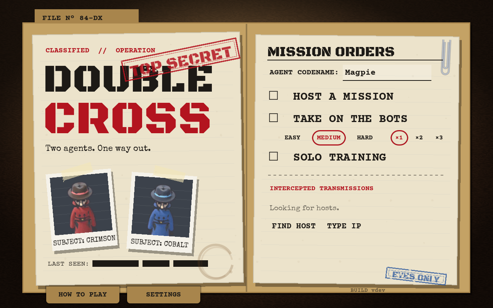
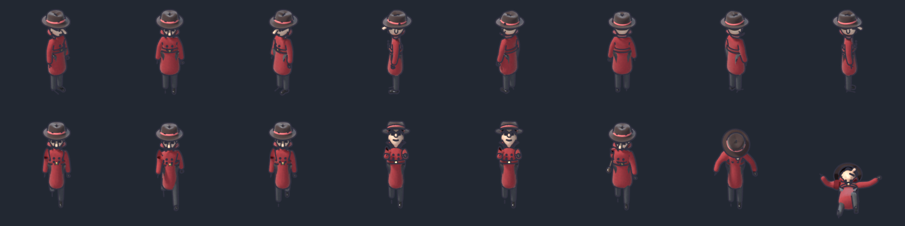

<p align="center">
  
</p>

<p align="center">
  <b>Rival agents. One secret base. Only one gets out.</b><br>
  A two-to-four-player, one-device-each game of sneaking, booby traps and very bad manners.
</p>

<p align="center">
  <a href="../../actions/workflows/android.yml"></a>
  
  
  
</p>

---

## The idea

Up to four agents, **Crimson**, **Cobalt**, **Amber** and **Jade**, have all
broken into the same secret base to steal the same intel. Each player has
their own phone, tablet or Mac on the same Wi-Fi, so nobody can see what the
others are up to. Or play alone against one to three bots.

- **Explore** a grid of isometric rooms: the Reactor Core, the Armoury, the Server Vault…
- **Search** desks, lockers, safes and crates for four pieces of intel.
- **Booby-trap** the furniture and doorways for your rivals to find the hard way.
- **Carry the right gadget** to disarm a trap before it disarms you.
- **Fight** when you meet: a cosh up close or a dart pistol across the room.
- **Escape** with all four pieces before your own clock runs out.

It's a love letter to **Spy vs. Spy**, the 1984 split-screen classic where two
spies booby-trapped an embassy while hunting for a briefcase full of secrets.
Double Cross keeps that mischievous trap-and-sneak spirit but is built from
scratch: one device per player over Wi-Fi, an isometric secret base, and its
own characters, artwork, sound, music and code. See [Acknowledgements](#acknowledgements).

<p align="center">
  
  
</p>
<p align="center">
  
  
</p>

## How a match plays

**The goal.** Four pieces of intel, a PASSPORT, CASH, MICROFILM and a KEYCARD,
are hidden in the furniture, one of each. Collect all four and walk out of the
**EXIT** (green on the mini-map). First one out wins.

**Searching.** Stand by furniture until it glows and press SEARCH. Without a
**BRIEFCASE** you can carry only one item: search with full hands and you swap,
leaving yours behind for someone else to find. There's one briefcase fewer than
there are agents, so somebody always goes without.

**Traps** (up to three each, and only you can see your own, though they still
work on you):

| Trap | Where | Beaten by |
|---|---|---|
| **Bomb** | in furniture | Extinguisher |
| **Spring trap** | in furniture | Toolkit |
| **Shock trap** (fries you, skeleton and all) | in furniture | Rubber gloves |
| **Tripwire** | across a doorway | Wire cutters |

Getting caught knocks you out for a few seconds, costs **20 seconds** and sends
any intel you're carrying flying into the furniture around the room. A gadget
is used up when it saves you, then turns up somewhere else in the base.

**Fighting.** Swing your cosh up close or fire a dart (three per life,
auto-aimed at a rival roughly in front of you). Three hits take an agent out:
they drop their intel, lose **30 seconds** and wake up back in their starting
room.

**Clocks.** Every agent has their own clock: 4, 6, 8 or 10 minutes for a two-agent
game (set by the host), scaled up for the bigger bases. Under 30 seconds the
room's alarm light starts beating. If your clock runs out you're out of the
mission and your intel scatters; the last agent still in wins.

**Air vents.** Some rooms have a crawl-through vent that joins a room two or
more rooms away. Stand at one and press CRAWL. The ones you've used appear on
your mini-map.

**The base** is generated from a random number shared by every device, so
everyone sees the same map, and it's different every match. It grows with the
party: 3×3 rooms for two agents, 4×3 for three, 4×4 for four.

### Playing against bots

**TAKE ON THE BOTS** puts you against one, two or three computer agents that
play by the same rules: they have to search to find things, can carry one
item until they find a briefcase, remember what they've searched and set traps
of their own. **EASY** bots are slow, forgetful, ignore the air vents and now
and then walk into their own traps; **MEDIUM** ones learn the vents as they go;
**HARD** ones know every vent from the start and are quickest to pick a fight
with anyone carrying intel. **SOLO TRAINING** lets you explore alone.

## Look and sound

- **Art from Blender:** the agents, furniture, floors and walls are 3D models
  built and rendered entirely by script, with normal maps, so the rooms' real
  2D lights (ceiling lamps, wall strips, screens, the exit's daylight,
  explosions, the alarm) shade every surface.
- **Effects:** fireballs and soot, spring launches, lightning and an x-ray
  skeleton for the shock trap, a duct cut-away when you crawl through a vent,
  screen shake, a moment of slow motion on knockouts, film grain, and an iris
  wipe between rooms.
- **Sound:** every effect and the music are synthesised by `tools/make_audio.py`,
  with no samples: wooden knocks and drawer thuds when searching, heel-and-toe
  footsteps on steel, layered explosions, a stuttering mains buzz, typewriter
  keys and rubber stamps. Sounds from other rooms are muffled through the walls.
- **Room tone:** each room has its own quiet background (air-conditioning,
  server racks with clicking relays, or dripping pipes), crossfading as you move.
- **Voices:** agents grunt when hit, cry out when knocked down, shriek when
  electrocuted and crow "ha-HAH!" when they win, each at their own pitch.
- **Music that reacts:** the spy-jazz loop is three loops played together. A
  shaker, toms and a low swell come in while a rival is in your room; driving
  hats, brass stabs and a rising riff come in when your clock is nearly out.
- **Spy-file screens:** the title screen is a case-file dossier, each match
  opens with a briefing that self-destructs, and ends with a stamped debrief.
- **First person (experimental):** the **1ST PERSON** button (or <kbd>Tab</kbd>)
  switches to seeing the room through your agent's eyes: real 3D walls,
  floor and Blender-modelled furniture, with the other agents as *Doom*-style
  cut-outs from their sprite sheets. Forward and back walk, left and right
  turn. Effects and trap markers only show in the overhead view for now.
- **Readable for everyone:** each agent has a shape as well as a colour
  (● Crimson, ▲ Cobalt, ■ Amber, ◆ Jade) on their name tag and clock, and new
  players get a few one-off tips on the ticker tape.

## Playing it

### Download

No GitHub account needed. Every update to `main` publishes a new
[**release**](https://github.com/petherin/doublecross/releases/latest), and these links
always fetch the newest one:

| | |
|---|---|
| **Android** phones and tablets | [⬇ DoubleCross.apk](https://github.com/petherin/doublecross/releases/latest/download/DoubleCross.apk) |
| **Mac** with Apple Silicon (M1 and later) | [⬇ DoubleCross-macOS-AppleSilicon.zip](https://github.com/petherin/doublecross/releases/latest/download/DoubleCross-macOS-AppleSilicon.zip) |
| **Mac** with an Intel processor | [⬇ DoubleCross-macOS-Intel.zip](https://github.com/petherin/doublecross/releases/latest/download/DoubleCross-macOS-Intel.zip) |

Not sure which Mac you have? **Apple menu → About This Mac** shows *Chip: Apple M…* or *Processor: Intel…*.

Older builds are on the [releases page](https://github.com/petherin/doublecross/releases).
Each build has a higher version number, so a new APK installs over the old one.
**Everyone in a match needs the same version**: the host turns away a device
running a different one and says which version each side has.

### On Android phones and tablets

1. On each device, download [**DoubleCross.apk**](https://github.com/petherin/doublecross/releases/latest/download/DoubleCross.apk)
   and open it. Android will ask you to allow installs from that source the first time.
2. Put all the devices on **the same Wi-Fi network**.
3. On one, type a codename and choose **HOST A MISSION**.
4. On the others, tap **JOIN AGENT …** under **INTERCEPTED TRANSMISSIONS** when
   the host appears. **FIND HOST** looks again straight away; **TYPE IP** is the
   fallback (the host's screen shows its address).
5. Once everyone's in the lobby (two to four agents), the host presses
   **START MISSION**. With four it starts by itself.

Phones and tablets can play together: wide screens get a wider view, and on
small screens the controls and text are scaled up.

> Some routers (guest networks, many office and hotel Wi-Fi networks) stop
> devices seeing each other. If the host doesn't show up, try **TYPE IP**, or
> a phone hotspot.

### As a Mac app

1. Download the zip for your Mac from the [Download](#download) table
   and unzip it to get **Double Cross.app**.
2. Drag it into **Applications**.
3. The app isn't signed with an Apple developer certificate, so the first time you open it macOS will
   refuse. Open **System Settings → Privacy & Security**, scroll down and click **Open Anyway** next to the
   Double Cross message. Or run this once in Terminal:

   ```bash
   xattr -dr com.apple.quarantine "/Applications/Double Cross.app"
   ```
4. When macOS asks whether Double Cross may find devices on your local network, click **Allow**.
   It needs that to find and join games.

A Mac can play against phones and tablets on the same Wi-Fi.

### From source in Godot (Mac, Windows or Linux)

1. Install **Godot 4.3** from [godotengine.org](https://godotengine.org/download/archive/4.3-stable/)
   (the standard version, not .NET).
2. In Godot, choose **Import** and pick this folder's `project.godot`.
3. **Solo:** press ▶ and choose **TAKE ON THE BOTS** or **SOLO TRAINING**.
4. **Several players on one computer:** go to **Debug → Customize Run Instances…**,
   tick **Enable Multiple Instances**, choose 2–4 and press ▶. In one window
   choose **HOST A MISSION**. In each of the others choose **TYPE IP**, enter
   `127.0.0.1` and press **JOIN**. Then press **START MISSION** in the host's window.

## Controls

| Action | Touch | Keyboard | Gamepad |
|---|---|---|---|
| Move | Drag on the left half of the screen | WASD / arrow keys | Left stick / D-pad |
| Search furniture (it glows) | **SEARCH** | <kbd>E</kbd> or <kbd>Space</kbd> | A |
| Set a trap | **TRAP**, then pick one | <kbd>1</kbd> bomb · <kbd>2</kbd> spring · <kbd>3</kbd> tripwire · <kbd>4</kbd> shock | LB bomb · RB spring · Back tripwire · right-stick click shock |
| Cosh | **ATTACK** | <kbd>F</kbd> | X |
| Fire a dart | **FIRE** | <kbd>G</kbd> | Y |
| Crawl through a vent | **CRAWL** (appears at a vent) | <kbd>V</kbd> | B |
| Switch overhead / first person | **1ST PERSON** / **OVERHEAD** (top bar) | <kbd>Tab</kbd> | Start |
| Skip the briefing | Tap | Any key | |
| Leave the match | **LEAVE** / Android back | Close the window | |

The keys are Godot input actions (**Project → Project Settings → Input Map**), so
they're easy to change.

**SETTINGS** on the title screen has music and effects volume, vibration, the
clock length, and a button to see the new-player tips again. **HOW TO PLAY**
is the field manual.

## Ideas for what's next

Suggestions, roughly in the order they'd pay off. Nothing here is promised.

**In progress:** new agent animations (crouching to set a trap, a dizzy sway
after a trap, a two-way flinch when hit, falling before lying flat), being
rendered in Blender.

### Top five

1. **Spectate when you're out.** Once your clock runs out you're left
   staring at a frozen agent. Let eliminated players follow the others room
   by room until the match ends.
2. **Bots in hosted games.** Let the host fill empty seats with bots, so two
   friends can play a full four-agent match.
3. **Reduced-motion setting.** One switch to turn off screen shake, flashes,
   slow motion and film grain, for players who find them uncomfortable.
4. **Survive a host dropping out.** Today the match ends for everyone if the
   host's device leaves or sleeps. Hand refereeing to another device, or at
   least let players rejoin a match after a brief disconnect.
5. **A match recap.** Add a timeline to the debrief card: who found what, who
   trapped whom, who took out whom, and each agent's escape time.

### Gameplay

- **More gadgets and traps:** a smoke bomb that hides you from everyone in the
  room, a glue trap that slows you down, a bug you plant to see into another
  room, and decoy intel that looks real until you reach the exit.
- **Locked rooms:** some doors need the KEYCARD, making it worth grabbing early.
- **Team mode:** two against two, sharing a briefcase and escaping together.
- **Match options for the host:** how many traps each, fewer briefcases,
  hidden exit, faster clocks.
- **Bot personalities:** a trapper who rigs everything, a brawler who hunts
  you, a sneak who uses every vent.
- **Pause** in one-player games.

### Look and feel

- **Doors and drawers that open:** animated doorways, and furniture doors that
  swing open when searched (a second Blender render of each piece).
- **First person, finished:** the first version is in (see below). Still to
  come: the furniture's full materials in 3D, trap markers and vents, the
  explosions and other effects, and a look-around swipe on touch screens.
- **Taunts:** a button to make your agent gloat, wave or shake a fist.
- **Stats and achievements** kept on the device: wins, fastest escape, traps
  sprung, rivals taken out.
- **A guided first mission** with the bot, instead of tips alone.

### Reaching more players

- **Play over the internet**, not just the same Wi-Fi, through a small relay
  server or a join code.
- **Store releases:** Google Play (needs a release signing key and a developer
  account), and a signed, notarised Mac app so macOS stops warning about it
  (needs an Apple developer account).
- **More platforms:** Godot can also build for Windows, Linux, iPhone and iPad.
- **Remappable controls** in SETTINGS, full gamepad navigation of the menus,
  and **translations** of the on-screen text.

### Under the hood

- **Profiling on low-end Android** phones for frame rate and battery use.
- **Screenshot tests** in CI, comparing key screens against approved images so
  visual changes are caught in review.
- **Network tests:** a host and joiners as separate processes in CI, playing a
  short scripted match.

## How it's built

- **[Godot 4.3](https://godotengine.org/)** using GDScript and the *Compatibility*
  renderer, so it runs on older devices too. Everything except the main scene is
  built in code.
- **Networking:** the host runs the match over ENet on UDP port `47810` and
  referees every search, trap, hit and escape, so all devices agree. Hosts
  announce themselves on UDP port `47811`, and joiners also probe every address
  on their subnet on port `47812` (many Android phones ignore broadcasts).
- **Isometric projection:** the game logic happens on a flat floor plan and the
  renderer projects it to isometric. Controls are screen-relative.
- **Reproducible matches:** the base, the bots' decisions and the referee's dice
  all come from the match's seed, so a given match replays exactly (handy for tests).

```
scripts/
  main.gd               menu ⇄ lobby ⇄ match flow
  core/                 autoloads and shared data
    net.gd                hosting, joining, discovery, version check ("Net")
    settings.gd           saved player settings ("Settings")
    sound.gd              effects, music layers, room tone, audio buses ("Sound")
    world.gd              the seeded base: rooms, furniture, items, vents, exit
  game/                 one match
    game.gd               setup, input, shared match state, network endpoints
    referee.gd            the rules: searches, traps, doors, hits, clocks
    event_presenter.gd    shows each event on this device: animation, text, sound
    agent.gd              one spy: movement, sync, sprite drawing
    bot.gd                computer opponents (room routing + AStarGrid2D)
    tips.gd               one-off tips for new players
  render/               drawing the room
    room_view.gd          isometric renderer and depth sorting
    room_effects.gd       explosions, springs, sparks, hits, dust
    wall_decor.gd         screens, maps, clocks and posters on the walls
    room_lights.gd        real 2D lights; light_layer.gd adds glows and shafts
    art.gd, grain.gd      shared textures, film grain
  ui/                   menus and HUD
    menu.gd               the dossier title screen and lobby
    hud/                  in-match HUD, briefing, debrief, duct view, iris wipe
    style.gd, icons.gd    paper, stamps, fonts, drawn icons
    joystick.gd, action_button.gd, ui.gd   touch controls, screen sizing
tests/
  smoke.gd              every script compiles, inputs mapped, 300 seeds of base rules
  bot_match.gd          a full match against 1–3 hard bots must end in an escape
tools/
  make_audio.py         synthesises every sound, voice, ambience and music loop
  blender/              models and renders agents, furniture and room surfaces
  thin_macos_template.py  splits Godot's universal Mac template per processor
```

### Tests and CI

Every push and pull request runs `gdlint` over the scripts, the smoke test, and
bot matches with two and four agents (GitHub Actions, `.github/workflows/android.yml`).
Only after a change reaches `main` are the APK and both Mac apps built and
published as a release. To run the tests yourself:

```bash
godot --headless -s res://tests/smoke.gd
godot --headless --fixed-fps 60 -s res://tests/bot_match.gd -- --bots=3 --seed=7
```

### Re-rendering the art in Blender

Every piece of 3D art is built, posed and rendered by script, using Blender 4.2
as a Python module:

```bash
python3.11 -m venv .blendenv
.blendenv/bin/pip install bpy==4.2.0 pillow
.blendenv/bin/python tools/blender/build_agents.py                 # all four agents
.blendenv/bin/python tools/blender/build_agents.py --only amber    # just one
.blendenv/bin/python tools/blender/build_crawl.py                  # duct-crawl sheets
.blendenv/bin/python tools/blender/build_furniture.py --only safe  # furniture
.blendenv/bin/python tools/blender/build_rooms.py                  # floor and wall surfaces
```

`tools/blender/agent_model.py` sculpts each spy procedurally: a body skinned
around a jointed skeleton (so knees and elbows really bend), a head with a big
spy nose, brows, smirk and shades, a snap-brim fedora, a belted trench coat,
gloves and polished shoes. `build_agents.py` poses it and renders 8 directions
of every animation (idle, walk, run, search, cosh swing, hurt, knocked down,
victory) with ink outlines from an orthographic camera at the game's isometric
angle, plus a normal map for every frame, then `pack_sprites.py` trims and packs
the frames into compact atlases. Add `--preview` for small, quick renders.

<p align="center"></p>

`build_furniture.py` models every piece (desk with monitor and mug, control
console, filing cabinet, lockers, TOP SECRET crate, bookcase, safe, potted plant,
gadget rack, sofa) in game units and renders it for each wall it can stand
against, at exactly the game's scale so the sprites line up with the collision
boxes. `build_rooms.py` renders the steel tread-plate floor and riveted wall
panels as tiling textures with normal maps.

### Regenerating the audio

```bash
python3 tools/make_audio.py              # everything
python3 tools/make_audio.py zap boom     # just these effects
python3 tools/make_audio.py music        # the three music loops
python3 tools/make_audio.py ambience     # the room-tone loops
```

It needs `numpy`, and `ffmpeg` for the Ogg loops.

### Building the apps yourself

Install the Android SDK and OpenJDK 17, set their paths in **Editor → Editor
Settings → Export → Android**, then use **Project → Export…**. The Mac presets
need the single-processor templates that CI makes with `tools/thin_macos_template.py`.

`android/debug.keystore` is a throwaway **debug-only** signing key (password
`android`). It's committed so every build is signed the same way and installs
over the previous one. Never use it for a store release.

## Fonts

- **Black Ops One** by James Grieshaber (SIL Open Font License 1.1)
- **Special Elite** by Astigmatic (Apache License 2.0)
- **Courier Prime** by Quote-Unquote Apps (SIL Open Font License 1.1)

The fonts and their licence files are in `assets/fonts/`. They're covered by
their own licences, not by this project's.

## Acknowledgements

Double Cross is inspired by **Spy vs. Spy** (1984), the computer game by
First Star Software based on Antonio Prohías's *Spy vs. Spy* comic strip in
*MAD* Magazine, and by the many happy hours spent playing it split-screen on
8-bit machines.

Double Cross is an independent, original fan project. It does not use any
artwork, characters, names, music or code from Spy vs. Spy, and is not
affiliated with, endorsed by or connected to First Star Software, *MAD*
Magazine, DC Comics or Warner Bros. *Spy vs. Spy* is a trademark of its
respective owners.

## Licence

Copyright © 2026 petherin. **All rights reserved.** The code is public so you can
look at it, but you may not copy, reuse, modify or distribute any of it without
written permission. See [LICENSE](LICENSE).
